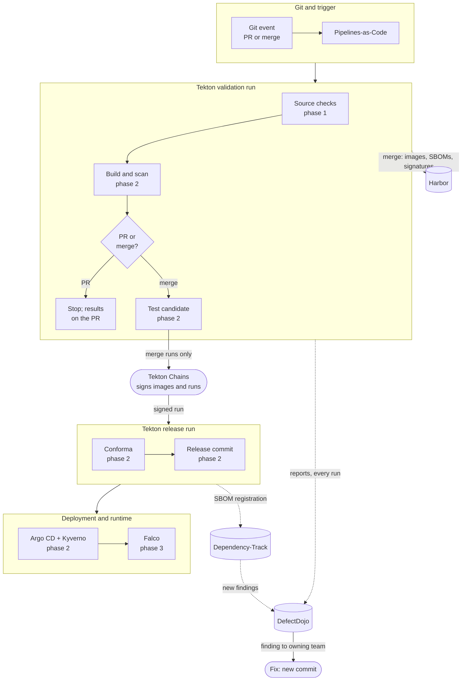
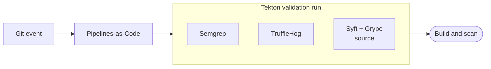
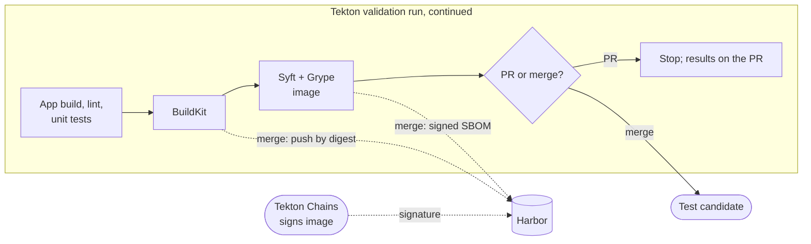
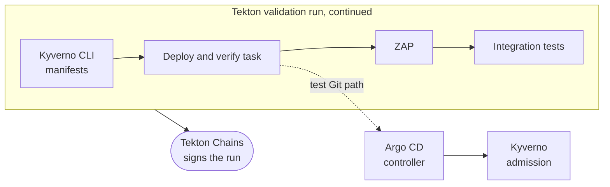
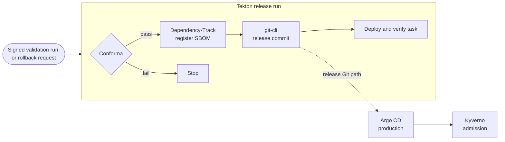
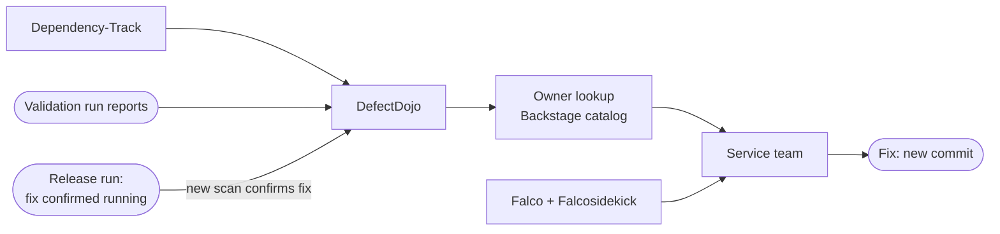

# Open Source CI/CD Reference Architecture for SSDF

**Draft 0.13 · Conceptual: not yet demonstrated.**

This reference architecture connects open source tools into a CI/CD workflow aligned with
the [Cybersecurity SIG's guidance](https://cybersecurity.cd.foundation/docs/). It follows one
container image from commit to production, and back to the team that owns it when a new
vulnerability is found. It takes its approach from NIST's
[NCCoE DevSecOps](https://pages.nist.gov/nccoe-devsecops/) example implementations, but every
component here is open source.

It's written for platform engineers designing or extending a shared delivery pipeline. The
first diagram shows what runs where. The sections after it follow the SIG's three phases.
Each table lists steps in the order they run: the tool, what it does and why, what stops
progression, the SIG task it aligns to, and a SIG-listed alternative.

Scope: containerized services on Kubernetes. Out of scope: cluster provisioning, Git host
choice, language-specific tooling, and malware scanning (no SIG-listed tool).

## End-to-end delivery architecture

Pull requests run source checks and build and scan, then stop. Merges, which have passed
the team's review process, continue with the same image digest through test, release and
deployment. Nothing is rebuilt after testing.

## Phase 1: Code and Prebuild

Validate the source revision before its image is built.

Every check in the validation run reports two ways. Its pass/fail result is signed into the
run's provenance, and its full report goes to DefectDojo, with retry if the upload fails
(integration).

| Tool | What it does here, and why | Blocks when | SIG task | SIG-listed alternative |
| --- | --- | --- | --- | --- |
| Pipelines-as-Code | Starts a Tekton validation run for each PR or merge at its exact commit, using the default branch's pipeline definition. Posts status and report links to the commit | Unsigned webhook, or repo or event not allowed: no run | [1.1 PO.3.1](https://cybersecurity.cd.foundation/docs/phase-1/ssdf/ssdf-po/#po3-implement-supporting-toolchains) | — |
| Semgrep CE | Static analysis with open source rules. Which rule source is still unresolved: Semgrep's maintained rule set isn't open source | Finding above policy threshold | [1.3 PW.7.1](https://cybersecurity.cd.foundation/docs/phase-1/ssdf/ssdf-pw/) | Bandit (Python only) |
| TruffleHog | Scans the commit history for secrets, with live verification off | Any unresolved secret | [1.3 PW.8.1](https://cybersecurity.cd.foundation/docs/phase-1/ssdf/ssdf-pw/) | Gitleaks |
| Syft + Grype | Inventories source dependencies and checks them for known vulnerabilities, so developers see problems before the build | Vulnerability above policy threshold | [1.3 PW.6.1–PW.6.2](https://cybersecurity.cd.foundation/docs/phase-1/ssdf/ssdf-pw/) | Trivy (does both) |

## Phase 2: Build and Deploy

Build and test the image, evaluate the release evidence, and deploy the approved digest.

Image checks record which digest they checked, so release evidence can't come from a
different image. Conforma's policy lists the required checks by name, so a check that never
ran blocks release just like one that failed.

### Build and scan

Still inside the validation run.

| Tool | What it does here, and why | Blocks when | SIG task | SIG-listed alternative |
| --- | --- | --- | --- | --- |
| App build, lint and unit tests | Tekton runs the application's own build, lint and unit-test commands, in a pipeline task or the Dockerfile's build stage | Any command fails | — | — |
| BuildKit † | Builds the image (multistage Dockerfile, pinned base image). PR runs keep it as a local file; merges push it to Harbor by digest | Build fails | [2.3 PW.6.1–PW.6.2](https://cybersecurity.cd.foundation/docs/phase-2/ssdf/ssdf-pw/) | apko (builds from a package list, no Dockerfile) |
| Syft | Generates the finished image's CycloneDX SBOM. On merges, Cosign signs it as an attestation on the image (`cosign attest`) | — | [2.3 PW.6.1–PW.6.2](https://cybersecurity.cd.foundation/docs/phase-2/ssdf/ssdf-pw/); Cosign: [2.2 PS.2.1](https://cybersecurity.cd.foundation/docs/phase-2/ssdf/ssdf-ps/) | Trivy (also scans) |
| Grype | Checks the image SBOM for known vulnerabilities, and reports which digest it checked | Vulnerability above policy threshold | [2.1 PO.4.1–PO.4.2](https://cybersecurity.cd.foundation/docs/phase-2/ssdf/ssdf-po/) | Trivy |
| Tekton Chains | Signs each pushed image as soon as its build task finishes, with a key only Chains can read | Signing unavailable: Kyverno won't admit the image | [2.2 PS.1.1](https://cybersecurity.cd.foundation/docs/phase-2/ssdf/ssdf-ps/) | Cosign (explicit signing step instead of automatic) |
| Harbor | Stores pushed images with their SBOMs, signatures and attestations. The build and Chains push with separate accounts | Push from any other account | [2.2 PS.3.1](https://cybersecurity.cd.foundation/docs/phase-2/ssdf/ssdf-ps/) | — |

† BuildKit isn't listed by the SIG for this task. It's included as the most widely used
Dockerfile builder (Docker's default).

### Test the candidate

Merges only, still inside the validation run.

| Tool | What it does here, and why | Blocks when | SIG task | SIG-listed alternative |
| --- | --- | --- | --- | --- |
| Kyverno CLI | Checks the rendered deployment manifests against the same policies the cluster enforces, before anything deploys | Any violation | [2.3 PW.9.1](https://cybersecurity.cd.foundation/docs/phase-2/ssdf/ssdf-pw/) | Open Policy Agent (Conftest) |
| Deploy and verify task | Tekton catalog tasks commit the digest to the test Git path, have Argo CD sync and wait for health; a final step checks the running pods use that digest (integration) | Sync fails, app unhealthy, or wrong digest running | — | — |
| Argo CD | Deploys the test Git path into an isolated test namespace | Sync fails | [2.1 PO.5.1–PO.5.2](https://cybersecurity.cd.foundation/docs/phase-2/ssdf/ssdf-po/) | Flux CD |
| Kyverno | Admits only images signed by Chains and pinned by digest | Unsigned, wrong signer, or tag reference | [2.2 PS.2.1](https://cybersecurity.cd.foundation/docs/phase-2/ssdf/ssdf-ps/) | Open Policy Agent (needs a separate signature-verification add-on) |
| ZAP | Scans the running candidate's HTTP and API endpoints, authenticated where the app needs it | Alert above policy threshold, or scan incomplete | [2.3 PW.8.1](https://cybersecurity.cd.foundation/docs/phase-2/ssdf/ssdf-pw/) | — |
| Integration tests | The team's tests against the running candidate | Failed test | — | — |
| Tekton Chains | When the validation run ends, signs SLSA provenance for the whole run, recording each check's result against the built image's digest (configuration to validate) | Signing unavailable: nothing to release | [2.2 PS.1.1](https://cybersecurity.cd.foundation/docs/phase-2/ssdf/ssdf-ps/) | in-toto (attestation format; needs its own signing step) |

### Release and deploy

A separate Tekton release run starts once Chains has signed the validation run
(integration). It runs in its own namespace under the only service account that can write
the release Git path. Application tasks never have access to signing or release credentials.

| Tool | What it does here, and why | Blocks when | SIG task | SIG-listed alternative |
| --- | --- | --- | --- | --- |
| Conforma | Checks against versioned policy: the image signature, the signed SBOM attestation, and the run's provenance, with every required check present, passed and reported for this digest | A required check missing, failed or skipped; results for another digest; signature or SBOM attestation missing | [2.1 PO.1.1](https://cybersecurity.cd.foundation/docs/phase-2/ssdf/ssdf-po/) | Open Policy Agent (Conftest; you write the signature and provenance rules) |
| Dependency-Track | Registers the image SBOM under the service and digest, and confirms processing finished | Registration not confirmed | [3.1 PO.3.1](https://cybersecurity.cd.foundation/docs/phase-3/ssdf/ssdf-po/) | Ortelius |
| git-cli (Tekton catalog) | Commits the approved digest to the release Git path. This commit is the release approval | Another writer, or the Git head moved since Conforma's check | — | — |
| Deploy and verify task | Tekton catalog tasks have Argo CD sync production and wait for health; a final step checks the running pods use the released digest (integration) | Sync fails, app unhealthy, or wrong digest running | — | — |
| Argo CD | Syncs production from the release path only | Sync fails | [2.1 PO.2.1](https://cybersecurity.cd.foundation/docs/phase-2/ssdf/ssdf-po/) | Flux CD |
| Kyverno | Repeats the signature and digest check, and enforces workload rules such as non-root and no privileged pods | Any violation | [2.1 PO.5.1–PO.5.2](https://cybersecurity.cd.foundation/docs/phase-2/ssdf/ssdf-po/), [2.2 PS.3.1](https://cybersecurity.cd.foundation/docs/phase-2/ssdf/ssdf-ps/) | Open Policy Agent (needs a separate signature-verification add-on) |

Build provenance (Chains) records how the image was built. The release commit (git-cli) is
the decision that it may deploy.

**Rollback** releases a previous release's digest and deployment configuration through the
same release checks.

## Phase 3: Post Deploy

Monitor deployed software and route findings through fix and reassessment.

| Tool | What it does here, and why | Blocks when | SIG task | SIG-listed alternative |
| --- | --- | --- | --- | --- |
| Dependency-Track | Re-checks every released SBOM as new vulnerabilities are published | No gate; raises findings | [3.4 RV.1.1](https://cybersecurity.cd.foundation/docs/phase-3/ssdf/ssdf-rv/) | Ortelius |
| DefectDojo | Holds every validation-run report, including failed runs, with the original files attached, plus Dependency-Track findings; deduplicates them | Failed imports stay visible and are retried | [3.4 RV.2.1](https://cybersecurity.cd.foundation/docs/phase-3/ssdf/ssdf-rv/) | Ortelius |
| Backstage catalog + owner lookup | Looks up the service's owning team and assigns the finding to them in DefectDojo (integration) | — | [3.1 PO.2.1](https://cybersecurity.cd.foundation/docs/phase-3/ssdf/ssdf-po/) | — |
| Falco + Falcosidekick | Detects suspicious runtime behavior and alerts the service's team, routed by namespace label | No gate | [3.1 PO.5.1–PO.5.2](https://cybersecurity.cd.foundation/docs/phase-3/ssdf/ssdf-po/) | — |
| DefectDojo | Findings close after the fix is deployed and a new, complete scan confirms it, or a mitigation is recorded (integration). History shows repeat issues | Failed or incomplete scans never close findings | [3.4 RV.2.1](https://cybersecurity.cd.foundation/docs/phase-3/ssdf/ssdf-rv/), [3.4 RV.3.1–RV.3.2](https://cybersecurity.cd.foundation/docs/phase-3/ssdf/ssdf-rv/) | — |
